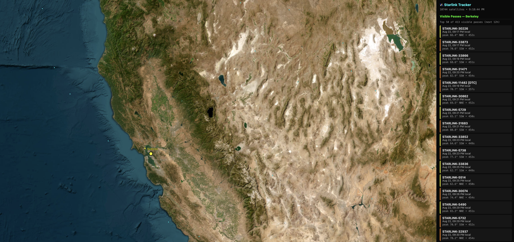

# Starlink Tracker

Real-time 3D visualization of the Starlink satellite constellation, with pass
predictions for a configured observer location. Runs as a self-contained
container on a Raspberry Pi (or anywhere Docker runs).



## Features

- Live 3D globe (CesiumJS) showing all ~10,000+ Starlink satellites, updating every 3s
- Vectorized SGP4 propagation — computes the whole constellation in well under a second
- Visible pass predictions for a configured observer (default: Berkeley, CA)
  - Filters to genuinely observable passes (observer in twilight/darker, satellite sunlit)
  - Returns top 50 passes by peak elevation over the next 12h
- Ground station marker on the globe
- Click a pass in the sidebar to fly the camera to that satellite
- Fully self-contained — no API keys, no external map tokens (uses ArcGIS World Imagery)

## Quick start

```bash
git clone https://github.com/jj358mhz/starlink-tracker.git
cd starlink-tracker
docker compose up -d
```

Then open http://localhost:8765/

The first startup downloads a Starlink TLE from Celestrak (~2 MB) and the
JPL DE421 ephemeris (~17 MB). Both are cached in the `./data/` volume.

## Configuration

Observer location and thresholds are constants at the top of `main.py`:

| Constant | Default | Meaning |
|---|---|---|
| `OBS_LAT`, `OBS_LON`, `OBS_ELEV_M` | Berkeley, CA | Observer position |
| `PASS_HOURS_AHEAD` | 12 | How far ahead to compute passes |
| `MIN_PEAK_ELEVATION_DEG` | 20 | Minimum peak elevation for a pass to count |
| `MAX_PASSES_RETURNED` | 50 | Cap on passes returned to the frontend |
| `CACHE_SECONDS` | 1 | Position cache TTL |
| `PASS_CACHE_SECONDS` | 300 | Pass prediction cache TTL |
| `REFRESH_HOURS` | 8 | How often to re-fetch TLE |

## Endpoints

- `GET /` — Web UI
- `GET /positions` — Current lat/lon/altitude for every satellite (JSON)
- `GET /passes` — Upcoming visible passes for the configured observer (JSON)
- `GET /health` — Health check

## Architecture

- **Backend**: FastAPI + uvicorn, Skyfield for orbital mechanics, sgp4 for vectorized propagation
- **Frontend**: Static HTML + CesiumJS
- **Data**: TLE from [Celestrak](https://celestrak.org), ephemeris from JPL

## Development

```bash
python3 -m venv venv
source venv/bin/activate
pip install -r requirements.txt
uvicorn main:app --host 0.0.0.0 --port 8765 --reload
```

## License

MIT — see [LICENSE](LICENSE).
